# Hi, I'm Zorawar Singh Sandhu 👋

### Software Engineer | Python | Backend Development | AI/ML

I'm passionate about building practical software solutions, backend systems, and AI-powered applications. I'm continuously improving my engineering skills by building projects, learning new technologies, and exploring open-source software.

- 🔭 Exploring backend engineering, AI/ML, and Generative AI
- 🧪 Interested in software testing, automation, and reliable applications
- 🌱 Currently improving my Python, API development, and software engineering skills
- 💻 Check out my repositories below!

---

## 🛠️ Tech Stack

### Languages

### Backend & Web Development

### AI & Machine Learning

### Databases & Tools

---

<h2 align="center">📊 GitHub Analytics</h2>

  <i>A snapshot of my development activity and open-source journey.</i>

<picture>
  <source media="(prefers-color-scheme: dark)"
          srcset="./assets/overview.dark.svg">
  
</picture>

<h3 align="center">🔥 Contribution Activity</h3>

<picture>
  <source media="(prefers-color-scheme: dark)"
          srcset="./assets/contributions.dark.svg">
  
</picture>

<h3 align="center">📈 Contribution Momentum</h3>

<picture>
  <source media="(prefers-color-scheme: dark)"
          srcset="./assets/momentum.dark.svg">
  
</picture>

<h3 align="center">💻 Language Distribution</h3>

<picture>
  <source media="(prefers-color-scheme: dark)"
          srcset="./assets/languages.dark.svg">
  
</picture>

<h3 align="center">🚀 Repository Activity</h3>

<picture>
  <source media="(prefers-color-scheme: dark)"
          srcset="./assets/repositories.dark.svg">
  
</picture>

---

## 🚀 Featured Projects

<!-- Replace these examples with your strongest original projects. -->

- Explore my repositories: [View All Projects](https://github.com/ZorawarSinghSandhu?tab=repositories)

---

## 🤝 Connect With Me

---

⭐ Thanks for visiting my profile!
